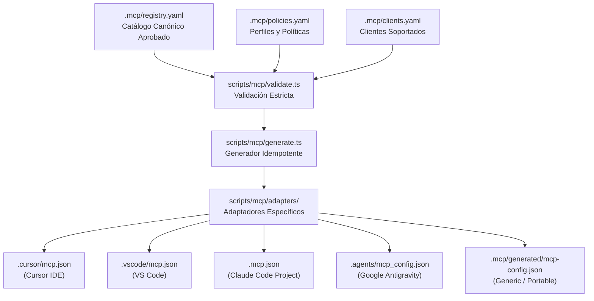

# Arquitectura e Integración MCP Gobernada (`.mcp`)

Este directorio contiene la especificación canónica, registro y políticas de seguridad para el Model Context Protocol (MCP) en `rocapellino/pokedex`.

---

## 1. Visión General y Arquitectura

La arquitectura MCP de Pokédex desacopla el catálogo de herramientas de los clientes específicos (Cursor, VS Code, Claude Code o agentes de IA):



### Separación Estricta de Responsabilidades

1. **Registro Canónico ([`registry.yaml`](registry.yaml)):** Fuente única de verdad de servidores autorizados, versiones fijas y metadatos.
2. **Políticas de Seguridad ([`policies.yaml`](policies.yaml)):** Definición de perfiles (`development`, `code-quality`, `github`, `infrastructure-readonly`, `infrastructure-write`, `ci`).
3. **Especificación de Clientes ([`clients.yaml`](clients.yaml)):** Declaración de clientes verificados y rutas de destino.
4. **Validación y Contratos ([`schema.json`](schema.json)):** Validación determinista y prevención de configuraciones inseguras.
5. **Generador y Adaptadores ([`scripts/mcp/generate.ts`](../scripts/mcp/generate.ts)):** Emisión reproducible e idempotente de configuraciones locales vía adaptadores especializados (`claude.ts`, `antigravity.ts`, `cursor.ts`, `vscode.ts`, `generic.ts`).

---

## 2. Perfiles de Seguridad

| Perfil | Propósito | Red | Filesystem | Escritura | Estado por Defecto |
| :--- | :--- | :--- | :--- | :--- | :--- |
| `development` | Herramientas locales de análisis y memoria contextual | none | `repo-root-only` | No | Habilitado |
| `code-quality` | Análisis estático de código y calidad en SonarQube | outbound | `read-only-repo` | No | Habilitado |
| `github` | Repositorios, issues y PRs autorizados (`rocapellino/pokedex`) | outbound | none | No | Habilitado |
| `infrastructure-readonly` | Consulta de métricas, telemetría y observabilidad | outbound | none | No | Habilitado |
| `infrastructure-write` | Operaciones de escritura en K8s o cloud | none | none | Sí | **Deshabilitado** |
| `ci` | Validación en GitHub Actions sin secretos operativos | isolated | `read-only-repo` | No | Habilitado |
| `security-readonly` | Análisis de seguridad de dependencias, imágenes OCI e infra | outbound | `read-only-repo` | No | Habilitado |
| `documentation-readonly` | Consulta de documentación técnica y APIs versionadas | outbound | none | No | Habilitado |

> [!IMPORTANT]
> El perfil `infrastructure-write` permanece deshabilitado por defecto. Ningún agente ni desarrollador debe utilizar servidores MCP para eludir el flujo formal de GitOps (ArgoCD) y Pull Requests.

Respecto a los límites de ejecución en modo local frente a contenedores:

> [!NOTE]
> **Frontera de Aislamiento:** En servidores con ejecución `local` (`stdio`), las restricciones de `filesystem` y `network` actúan como límites declarativos de gobernanza del catálogo y contrato para los clientes; el subproceso se ejecuta bajo los privilegios del sistema operativo del usuario. Cuando se requiera aislamiento estricto por sandbox de kernel (ej. `--network=none` o filesystem inmutable de solo lectura a nivel SO), debe configurarse el modo `container` con imagen fijada por digest SHA256 (como en `k8s-platform-write`).

---

## 3. Servidores Registrados y Estado

| ID | Nombre | Transporte | Modo | Paquete / Imagen | Versión | Perfil |
| :--- | :--- | :--- | :--- | :--- | :--- | :--- |
| `github` | GitHub Official | `stdio` | `local` | `@modelcontextprotocol/server-github` | `2025.4.8` | `github` |
| `filesystem` | Filesystem | `stdio` | `local` | `@modelcontextprotocol/server-filesystem` | `2026.8.31` | `development` |
| `memory` | Memory Graph | `stdio` | `local` | `@modelcontextprotocol/server-memory` | `2026.8.31` | `development` |
| `sonarqube` | SonarQube Launcher | `stdio` | `local` | `mcp-sonarqube-launcher` | `1.1.2` | `code-quality` |
| `observability-readonly` | Grafana Observability | `sse` | `remote` | Endpoint HTTPS con TLS | `1.0.0` | `infrastructure-readonly` |
| `k8s-platform-write` | K8s Platform Write | `stdio` | `container` | `alpine/k8s` (fijado por SHA256) | `1.32.0` | `infrastructure-write` (Inactivo) |
| `trivy` | Trivy Security Scanner | `stdio` | `local` | `trivy-mcp` | `0.1.0` | `security-readonly` |
| `context7` | Context7 Documentation | `stdio` | `local` | `@upstash/context7-mcp` | `4.4.0` | `documentation-readonly` |
| `postgres-readonly` | PostgreSQL Local Read-Only | `stdio` | `local` | `@modelcontextprotocol/server-postgres` | `0.6.2` | `infrastructure-readonly` |

---

## 4. Onboarding y Uso Diario

### Paso 1: Preparación Inicial

Ejecutar el asistente interactivo de preparación:

```bash
npm run mcp:setup
# O mediante Task:
task mcp:setup
```

El asistente verifica Node.js (>= 24), detecta Docker, valida el catálogo y emite las configuraciones locales ignoradas por Git.

### Paso 2: Configuración Segura de Variables

Para servidores que requieran credenciales (ej. `GITHUB_PERSONAL_ACCESS_TOKEN`, `SONAR_TOKEN`), defínalas en su entorno local o en `.env` local:

```bash
# Variables locales (NUNCA commitear)
export GITHUB_PERSONAL_ACCESS_TOKEN="ghp_..."
export SONAR_TOKEN="..."
```

### Paso 3: Diagnóstico del Entorno

Compruebe la salud integral de sus servidores, clientes y dependencias sin exponer secretos ni alterar el sistema:

```bash
npm run mcp:doctor
# O mediante Task:
task mcp:doctor
```

El diagnóstico evalúa de forma desacoplada y bajo principio Zero-Trust cuatro pilares:

1. **Sincronización de Clientes:** Verifica que las configuraciones locales de Cursor, VS Code, Claude Code, Antigravity y Generic coincidan con el catálogo canónico.
2. **Dependencias y Plugins:** Inspecciona Node.js, Docker, ejecutables locales y valida que plugins requeridos (como `trivy-mcp` mediante `trivy plugin list`) estén operativos.
3. **Variables de Entorno:** Audita la presencia de variables obligatorias (`CONFIG_MISSING`) sin imprimir jamás tokens ni secretos.
4. **Transporte y Esquema Seguro:** Valida mediante inspección estática que los endpoints remotos tengan sus variables de URL resueltas y declaren HTTPS obligatorio (o endpoints loopback locales).

---

## 5. Comandos Disponibles

| Comando npm | Tarea Taskfile | Acción Realizada |
| :--- | :--- | :--- |
| `npm run mcp:validate` | `task mcp:validate` | Valida catálogo, políticas, esquemas y ausencia de secretos |
| `npm run mcp:scan` | `task mcp:scan` | Escaneo estático Zero-Trust contra Tool Poisoning, Rug Pulls y RCE |
| `npm run mcp:generate` | `task mcp:generate` | Genera configuraciones nativas para todos los clientes |
| `npm run mcp:generate:check` | `task mcp:generate:check` | Valida sincronización en CI (falla si hay drift) |
| `npm run mcp:setup` | `task mcp:setup` | Asistente de onboarding y verificación de dependencias |
| `npm run mcp:doctor` | `task mcp:doctor` | Diagnóstico seguro de conectividad, runtime y variables |
| `npm run mcp:test` | `task mcp:test` | Ejecuta las suites de tests unitarios, contratos y seguridad |

---

## 6. Procedimiento para Modificar el Catálogo

1. **Alta de Servidor:**
   - Añadir la definición en [`registry.yaml`](registry.yaml) con versión semver explícita (prohibido `latest`).
   - Si utiliza contenedor, fijar la imagen obligatoriamente por digest SHA256 inmutable (`@sha256:`).
   - Asignar el perfil adecuado de [`policies.yaml`](policies.yaml).
2. **Validación:**
   - Ejecutar `npm run mcp:validate` y `npm run mcp:test`.
3. **Regeneración:**
   - Ejecutar `npm run mcp:generate`.
4. **Gobernanza:**
   - Superar el Markdown Quality Gate: `npm run lint:md -- .mcp/README.md`.
