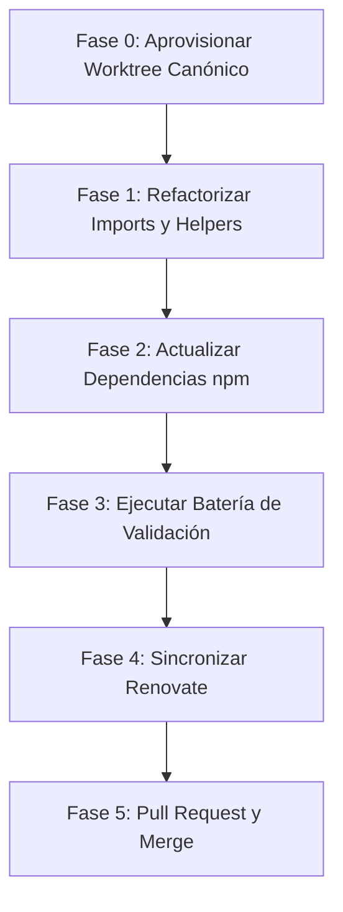

# Plan de Migración Técnica: js-yaml v4 a v5

> **Estado:** Histórico (documento auxiliar de planificación; su ejecución se llevará a cabo en una sesión posterior)
>
> **Fecha de captura:** 2026-10-14
>
> **Rama de trabajo:** `docs/plan-migracion-js-yaml-v5`
>
> [!IMPORTANT]
> Este documento es evidencia histórica y de planificación técnica generada tras el análisis del Dependency Dashboard ([Issue #586](https://github.com/rocapellino/pokedex/issues/586)). No es SSOT: el estado vigente reside en `apps/`, `infra/`, `gitops/`, `scripts/`, `tests/` y `docs/architecture/`.

---

## 1. Contexto y Justificación

### A. Diagnóstico Inicial

- La raíz del proyecto y scripts internos utilizan `js-yaml@^4.3.2` junto con `@types/js-yaml@^4.0.9`.
- Se mantienen resoluciones forzadas en `package.json` (`overrides`) para `markdownlint-cli` y `@lhci/utils` en `js-yaml@^5.4.2` para mitigar vulnerabilidades SCA.
- Renovate intentó actualizar `devDependencies` en el PR #836, pero fue cerrado debido a que la actualización directa rompió la resolución ESM de `scripts/detect-change-impact.ts`.
- Actualmente, Renovate mantiene una propuesta pendiente en el Dependency Dashboard ([Issue #586](https://github.com/rocapellino/pokedex/issues/586)) bajo la rama programada `renovate/js-yaml-5.x-lockfile`.

### B. Objetivos de la Migración

1. Unificar el árbol de dependencias eliminando versiones duplicadas de `js-yaml`.
2. Adoptar el soporte nativo de TypeScript de `js-yaml v5` y retirar `@types/js-yaml`.
3. Resolver de forma definitiva la advertencia recurrente en el Dependency Dashboard de Renovate.

```mermaid
flowchart TD
    subgraph Estado Actual
        A["package.json (root): js-yaml ^4.3.2"] --> D["scripts y tests (28 archivos)"]
        B["overrides: markdownlint-cli -> js-yaml ^5.4.2"]
        C["overrides: @lhci/utils -> js-yaml ^5.4.2"]
        R["Renovate: branch js-yaml-5.x-lockfile (bloqueada/pendiente)"]
    end
    subgraph Estado Objetivo
        M["package.json (root): js-yaml ^5.4.3"] --> D2["scripts y tests con 'import * as yaml'"]
        M --> T["Tipos nativos TypeScript (sin @types/js-yaml)"]
        D2 --> V["CI & Change Impact Verificados"]
    end
    Estado Actual ==>|Migración Controlada| Estado Objetivo
```

---

## 2. Breaking Changes y Consideraciones Técnicas

| Aspecto | `js-yaml` v4 (`^4.3.2`) | `js-yaml` v5 (`^5.4.3`) | Acción Requerida |
| :--- | :--- | :--- | :--- |
| **Exportación ESM** | Exportación por defecto (`import yaml from 'js-yaml'`). | Reescrita en TS sin default export. Solo *named exports*. | Migrar a `import * as yaml from 'js-yaml'` o `import { load, dump } from 'js-yaml'`. |
| **Definiciones TypeScript** | Requiere `@types/js-yaml` externo. | Tipos nativos incluidos en el paquete. | Desinstalar `@types/js-yaml` para evitar colisión de identificadores. |
| **Entrada Vacía en `load()`** | `yaml.load('')` devolvía `undefined`. | `yaml.load('')` arroja una excepción (`Error: Empty input`). | Robustecer `readYaml` en `tests/helpers/yaml.ts` y llamadas directas. |
| **YAML Merge Keys (`<<`)** | Soportado por defecto en `DEFAULT_SCHEMA`. | `CORE_SCHEMA` (YAML 1.2) no incluye `!!merge` por defecto. | Si se requiere merge keys, invocar con `{ schema: YAML11_SCHEMA }`. |
| **Estructura `!!set`** | Mapeado a objeto plano `{ key: true }`. | Mapeado a instancia de `Set` nativo de JavaScript. | Auditar si algún test inspecciona sets como objetos. |

---

## 3. Radio de Impacto (28 Archivos Identificados)

### A. Dependencias y Configuración

- `package.json`: `devDependencies` y `overrides`.
- `package-lock.json`: Sincronización del lockfile determinista.
- `scripts/declarations.d.ts`: Retirar `declare module 'js-yaml'`.

### B. Scripts Operativos y de CI (7 Archivos)

1. `scripts/detect-change-impact.ts` (Crítico: Gate principal de CI)
2. `scripts/verify-image-digest-parity.ts`
3. `scripts/mcp/doctor.ts`
4. `scripts/mcp/generate.ts`
5. `scripts/mcp/setup.ts`
6. `scripts/mcp/test-config.ts`
7. `scripts/mcp/validate.ts`

### C. Helpers y Suites de Pruebas (19 Archivos)

1. `tests/helpers/yaml.ts` (Helper central: `readYaml`, `readYamlDocs`, `workflowJobs`)
2. `tests/helpers/argocd.ts`
3. `tests/helpers/helm-render.ts`
4. `tests/helpers/taskfile.ts`
5. `tests/contracts/delivery/image_publication_contract.test.ts`
6. `tests/contracts/delivery/renovate_config_contract.test.ts`
7. `tests/contracts/governance/doc_governance.test.ts`
8. `tests/contracts/governance/skills_frontmatter.test.ts`
9. `tests/contracts/mcp/mcp_clients_contract.test.ts`
10. `tests/contracts/mcp/mcp_registry_contract.test.ts`
11. `tests/contracts/observability/grafana_cloud_collection.test.ts`
12. `tests/gitops/environment_http_contract.test.ts`
13. `tests/gitops/image_digest_promotion.test.ts`
14. `tests/gitops/platform_bootstrap_contract.test.ts`
15. `tests/security/dr_backup_security.test.ts`
16. `tests/security/iac_baseline_security.test.ts`
17. `tests/security/mcp/mcp_security_governance.test.ts`
18. `tests/security/supply_chain_tooling_pinning.test.ts`
19. `tests/unit/compose_postgres_tls.test.ts`

---

## 4. Plan de Ejecución Paso a Paso



### Fase 0: Aprovisionamiento de Worktree Gobernado

Conforme a la regla de gobernanza de worktrees (`AGENTS.md` y `.agents/rules/worktree-governance.md`):

```bash
npm run worktree:create -- --type chore --slug migrate-js-yaml-v5
```

### Fase 1: Refactorizar Imports y Helpers

1. En los **26 archivos** de código y tests:
   - Reemplazar `import yaml from 'js-yaml';` por `import * as yaml from 'js-yaml';`.
2. En `tests/helpers/yaml.ts`:
   - Proteger `readYaml` ante cadenas vacías para mantener compatibilidad con v4:

     ```typescript
     export function readYaml<T = any>(relativePath: string): T {
       const raw = fs.readFileSync(path.join(ROOT_DIR, relativePath), 'utf-8');
       if (!raw.trim()) return undefined as unknown as T;
       return yaml.load(raw) as T;
     }
     ```

3. En `scripts/declarations.d.ts`:
   - Eliminar el bloque `declare module 'js-yaml'` (innecesario gracias a los tipos nativos de v5).

### Fase 2: Actualización de Dependencias `npm`

1. Actualizar el paquete y retirar `@types/js-yaml`:

   ```bash
   npm install -D js-yaml@^5.4.3
   npm uninstall @types/js-yaml
   ```

2. En `package.json`:
   - Revisar la sección `overrides`: dado que la raíz usará `^5.4.3`, los overrides para `markdownlint-cli` y `@lhci/utils` pueden consolidarse o simplificarse.
3. Sincronizar y verificar el lockfile:

   ```bash
   npm ls js-yaml
   ```

### Fase 3: Ejecución de la Suite de Validación

Ejecutar la pirámide de verificación en orden de menor a mayor latencia:

1. **Tipado Estático:**

   ```bash
   npm run typecheck
   ```

2. **Impacto en CI:**

   ```bash
   npm run ci:detect-impact
   ```

3. **Calidad y Formato:**

   ```bash
   npm run lint
   ```

4. **Contratos y Seguridad:**

   ```bash
   npm run test:contracts
   npm run test:security
   npm run test:gitops
   ```

5. **Suite Completa y Fuzzing:**

   ```bash
   npm test
   npm run test:surface:check
   ```

### Fase 4: Sincronización de Renovate

- Tras mergear la migración a `main`, la rama `renovate/js-yaml-5.x-lockfile` en el Dependency Dashboard se cerrará automáticamente al detectar paridad con la línea `5.x`.

### Fase 5: Preparación de Pull Request

- Validar formato de PR con `npm run pr:validate`.
- Asegurar codificación UTF-8 estricta en PowerShell:

  ```powershell
  $utf8 = [System.Text.UTF8Encoding]::new($false)
  [Console]::InputEncoding = $utf8
  [Console]::OutputEncoding = $utf8
  $OutputEncoding = $utf8
  ```

- Publicar utilizando `gh pr create --body-file tmp/pr-body.md`.

---

## 5. Estrategia de Rollback

En caso de detectarse incompatibilidades sutiles durante la ejecución en CI:

1. Revertir el commit de la rama con `git revert HEAD`.
2. Reinstalar la versión anterior:

   ```bash
   npm install -D js-yaml@^4.3.2 @types/js-yaml@^4.0.9
   ```

3. Incorporar temporalmente en `renovate.json` la regla de supresión para evitar que el bot reabra la propuesta:

   ```json
   {
     "description": "js-yaml v5 suprimido temporalmente por incompatibilidad en scripts",
     "matchPackageNames": ["js-yaml", "@types/js-yaml"],
     "matchUpdateTypes": ["major"],
     "enabled": false
   }
   ```
