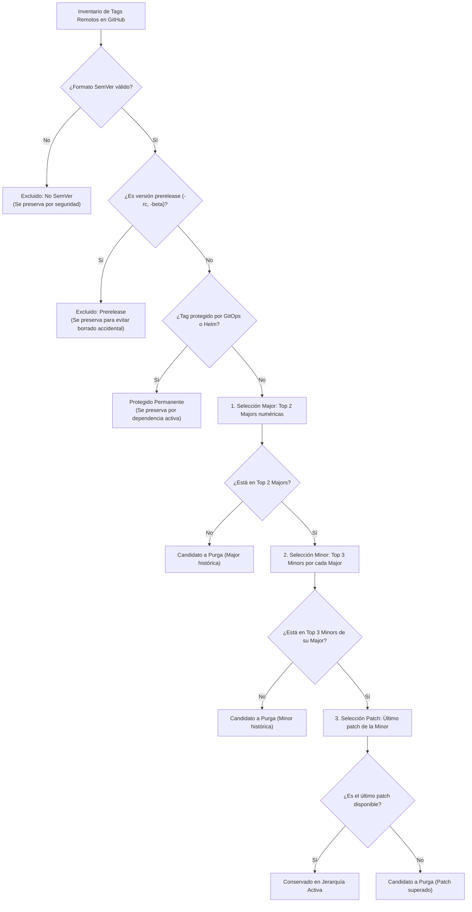

# Política de Retención Jerárquica de Git Tags en GitHub

## 1. Principio y Alcance

Conforme a las políticas de suministro seguro, trazabilidad inmutable y mantenimiento higiénico del repositorio, el proyecto adopta una política automatizada de **retención jerárquica basada en Semantic Versioning (SemVer 2.0)** para las referencias de versiones en **GitHub (`rocapellino/pokedex`)**.

Esta política sustituye la regla plana anterior por una **estrategia jerárquica de preservación de líneas de versión (Opción B)**, garantizando que se conserven activas las líneas de desarrollo recientes y el último estado estable de cada una.

### Objetivos Arquitecturales

1. **Trazabilidad por Línea de Versión (Major → Minor → Patch):** Preserva la línea actual y la previa inmediata (`N` y `N-1` majors), permitiendo dar soporte y auditar versiones vivas en paralelo.
2. **Último Estado Estable (Latest Patch):** Dentro de cada línea minor seleccionada, se conserva únicamente el último patch publicado, eliminando los parches intermedios históricos superados.
3. **Protección Multicapa de Despliegues Activos:** Las versiones referenciadas en GitOps ArgoCD (`gitops/apps/*`), plantillas Helm (`infra/helm/pokedex/Chart.yaml`) o listas explícitas de excepciones están blindadas frente a cualquier eliminación.
4. **Demarcación de Alcance de Objetos:** Opera exclusivamente sobre referencias remotas de Git (`refs/tags/*`). No elimina GitHub Releases, artefactos compilados, imágenes ni paquetes OCI en GHCR.

---

## 2. Reglas de Retención Jerárquica (Opción B)



### 2.1. Retención Major (Nivel 1)

- Se conservan las últimas **2 líneas major** estables (`keepMajorCount=2`), evaluadas numéricamente de forma descendente.
- Ejemplo: Si existen versiones `v3.x.x`, `v2.x.x` y `v1.x.x`, se seleccionan `v3.x.x` y `v2.x.x`. Las versiones de `v1.x.x` quedan fuera de la retención estándar.

### 2.2. Retención Minor (Nivel 2)

- Dentro de cada línea major seleccionada, se conservan las últimas **3 líneas minor** estables (`keepMinorCount=3`), evaluadas numéricamente de forma descendente.
- Ejemplo en `v3.x.x`: si existen `v3.4.x`, `v3.3.x`, `v3.2.x`, `v3.1.x` y `v3.0.x`, se seleccionan `v3.4.x`, `v3.3.x` y `v3.2.x`. Las minors `v3.1.x` y `v3.0.x` quedan fuera.

### 2.3. Retención Patch (Nivel 3)

- Dentro de cada línea minor seleccionada, se conserva **exclusivamente el último patch disponible** (`keepPatchCount=1`), evaluado numéricamente de forma descendente.
- Ejemplo en `v3.4.x`: si existen `v3.4.0` y `v3.4.1`, se conserva `v3.4.1`. La versión `v3.4.0` pasa a ser candidata a purga.

---

## 3. Ejemplo Práctico de Selección

Dada la siguiente colección de versiones estables en el repositorio:

```text
v1.4.0, v1.5.2
v2.1.0, v2.1.3, v2.2.0, v2.2.2, v2.3.0, v2.3.4, v2.4.0
v3.0.0, v3.1.0, v3.1.4, v3.2.0, v3.2.2, v3.3.0, v3.3.5, v3.4.0, v3.4.1
```

La política jerárquica aplica la siguiente resolución determinista:

| Nivel | Decisión | Tags Seleccionados / Explicación |
| :--- | :--- | :--- |
| **Majors Retenidas** | `v3.x.x` y `v2.x.x` | Las 2 líneas major más recientes. La línea `v1.x.x` queda fuera. |
| **Minors de `v3.x.x`** | `v3.4.x`, `v3.3.x`, `v3.2.x` | Las 3 minors más recientes de Major 3. Minors `v3.1.x` y `v3.0.x` quedan fuera. |
| **Patches de `v3.x.x`** | `v3.4.1`, `v3.3.5`, `v3.2.2` | Último patch de cada minor retenida. `v3.4.0`, `v3.3.0`, `v3.2.0` se purgan. |
| **Minors de `v2.x.x`** | `v2.4.x`, `v2.3.x`, `v2.2.x` | Las 3 minors más recientes de Major 2. Minor `v2.1.x` queda fuera. |
| **Patches de `v2.x.x`** | `v2.4.0`, `v2.3.4`, `v2.2.2` | Último patch de cada minor retenida. `v2.3.0` y `v2.2.0` se purgan. |
| **Resultado Activo** | **6 tags retenidos** | `v3.4.1`, `v3.3.5`, `v3.2.2`, `v2.4.0`, `v2.3.4`, `v2.2.2` |

---

## 4. Clasificación, Prereleases y Formato de Tags

- **Prefijo `v` opcional:** El analizador admite tanto `v1.2.3` como `1.2.3`, preservando el formato original del tag en el repositorio.
- **Tratamiento de Prereleases (`-rc.1`, `-beta.2`):** Como medida preventiva fundamental, los tags con prerelease **no desplazan versiones estables** ni se eliminan automáticamente. Se clasifican como `excluded` con registro del motivo.
- **Build Metadata (`+build.5`):** Se parsea conforme a SemVer 2.0 sin alterar la precedencia de versión. Si existen tags duplicados que apuntan a commits distintos (ambigüedad), la ejecución se aborta de forma segura.
- **Tags no SemVer:** Tags arbitrarios o experimentales (e.g. `nightly-2026`, `test-build`) se registran como `excluded` y se conservan sin mutaciones.
- **Tags Anotados vs Ligeros:** El script distingue entre el SHA del objeto de referencia Git (`refs/tags/X`) y el SHA del commit destino. Para tags anotados y firmados (generados por `release-tag.yaml`), el objeto tag se desreferencia automáticamente hacia su commit subyacente, garantizando que las precondiciones de SHA se comparen de forma fidedigna y sin falsos conflictos concurrentes.

---

## 5. Automatización y Seguridad en GitHub Actions

Workflow oficial: [`.github/workflows/tag-retention.yaml`](../../.github/workflows/tag-retention.yaml).

### Triggers y Modos de Ejecución

- **Post-Release (`workflow_run`):** Se dispara reactivamente tras el merge exitoso de una versión en `main` mediante `🏷️ Automated Semantic Release & Tag` (`release-tag.yaml`). Ejecuta exclusivamente la fase de planificación y auditoría en modo `dry-run` (solo lectura).
- **Semanal (`schedule`):** Domingos a las 05:00 UTC. Opera deliberadamente en modo `dry-run` como telemetría continua para auditar el estado del repositorio sin riesgo de mutación no supervisada.
- **Manual (`workflow_dispatch`):** Permite auditorías bajo demanda o la ejecución de purgas reales explícitamente autorizadas:
  - `dry_run`: `true` (por defecto). Para habilitar la eliminación real, el operador debe seleccionar explícitamente `dry_run: false`.
  - `major_count`: `2` (por defecto).
  - `minor_count`: `3` (por defecto).
  - `patch_count`: `1` (por defecto).

### Arquitectura de Dos Jobs y Menor Privilegio (Zero-Trust)

Para aislar de manera estricta las operaciones destructivas, el workflow divide la ejecución en dos jobs independientes:

1. **`plan-retention` (Solo Lectura):**
   - Declarado con `permissions: { contents: read }`.
   - Se ejecuta en todos los disparos (`workflow_run`, `schedule`, `workflow_dispatch`).
   - Descarga el repositorio (`persist-credentials: false`), ejecuta `scripts/tag-retention.ts` con `--dry-run` e imprime el plan y balance jerárquico.
   - En ejecuciones automáticas (`workflow_run` y `schedule`), el pipeline concluye aquí, garantizando que nunca se instancian credenciales de escritura en corridas desatendidas.
2. **`prune-tags` (Operación Destructiva Autorizada):**
   - Declarado con `permissions: { contents: write }`.
   - Condicionado estrictamente a `github.event_name == 'workflow_dispatch' && needs.plan-retention.outputs.dry_run == 'false'`.
   - Ejecuta la purga con doble verificación de SHA y precondiciones de integridad.

### Protocolo de Borrado Seguro

1. **Re-consulta y enriquecimiento paginado del inventario:** Justo antes de ejecutar mutaciones remotas, se consulta el estado de GitHub en tiempo real y se enriquece de forma exhaustiva mediante `git/matching-refs/tags` con paginación completa y control FAIL-CLOSED (hasta 3.000 referencias). En ejecuciones destructivas reales, el enriquecimiento opera en modo estricto (`strict: true`): cualquier fallo HTTP, error de red o tag del inventario que no se encuentre en las referencias remotas aborta inmediatamente la ejecución antes de emitir ningún `DELETE`. La tolerancia a fallos de enriquecimiento queda reservada exclusivamente para diagnósticos informativos en `dry-run`.
2. **Control FAIL-CLOSED de paginación:** Si el inventario de tags o el listado de matching-refs supera el tope de seguridad de 3.000 tags (30 páginas) y aún existen páginas pendientes en la API, la ejecución se detiene de inmediato mediante excepción para evitar formular planes o borrar referencias sobre un inventario parcial o truncado.
3. **Validación previa de integridad e identidad:** Comprueba que todos los tags conservados (`kept`) continúen existiendo en el repositorio remoto y que tanto su commit destino como su objeto de referencia (`refSha`) coincidan de forma idéntica con el inventario evaluado. Si un tag retenido muta o desaparece, la ejecución se aborta antes de borrar ningún tag.
4. **Verificación de precondición en dos fases y delimitación TOCTOU:** Para cada tag a purgar, compara el commit SHA actual (desreferenciado) y el objeto de referencia (`refSha`) contra los evaluados inicialmente en el inventario. Dado que la API Git Data de GitHub (`DELETE /repos/{owner}/{repo}/git/refs/tags/{tag}`) no soporta transacciones atómicas Compare-And-Swap (CAS) ni cabeceras condicionales `If-Match` para referencias Git, el proceso minimiza la ventana de carrera ejecutando la comprobación y la eliminación de forma contigua e inmediata; no obstante, se documenta formalmente la existencia de esta ventana TOCTOU inherente a la arquitectura de la API ante modificaciones remotas concurrentes.
5. **Concurrencia serializada:** Grupo `tag-retention-${{ github.ref }}` con `cancel-in-progress: false` para evitar colisiones entre corridas simultáneas.

---

## 6. Referencia de Comandos CLI

```bash
# Simulación local u offline con datos sintéticos:
node --experimental-strip-types scripts/tag-retention.ts --simulate

# Inspección en seco (Dry-Run) contra el repositorio remoto:
task tags:retention:dry-run
# o vía npm:
npm run tags:retention:dry-run

# Aplicación real con borrado seguro (requiere GITHUB_TOKEN con contents:write):
npm run tags:retention -- --no-dry-run

# Parámetros personalizados de jerarquía:
node --experimental-strip-types scripts/tag-retention.ts --major=3 --minor=2 --patch=1 --dry-run
```

---

## 7. Preparación para Política Futura (Opción A)

La arquitectura modular de [`scripts/tag-retention.ts`](../../scripts/tag-retention.ts) desacopla la evaluación de la interacción remota. Para una futura transición a la **Opción A (Retención Global)**:

- Criterio de la Opción A: Conservar las últimas 2 versiones major globales, las últimas 3 versiones minor globales (independientes de la major) y el último patch global.
- Procedimiento: Bastará con extender el selector en `evaluateHierarchicalTagRetention` introduciendo una estrategia `global_latest` configurable mediante `--strategy=global`, manteniendo la misma infraestructura de consulta, protección de GitOps y borrado seguro.
