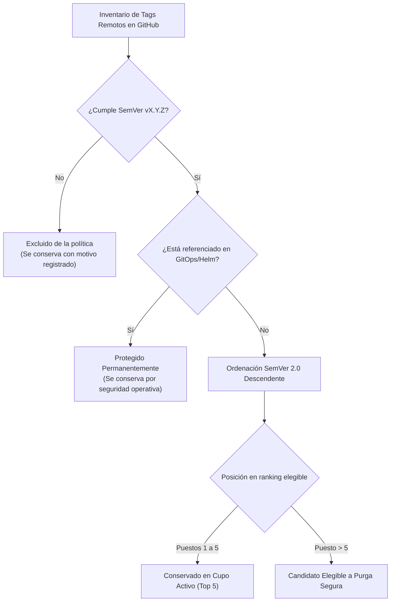
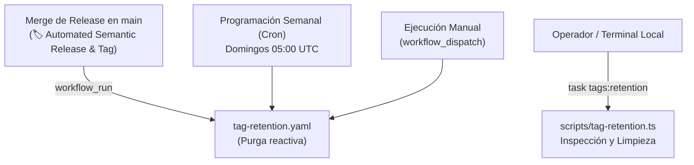

# Política de Retención y Purgado Automático de Tags en GitHub

## 1. Principio y Alcance

Conforme a las políticas de suministro seguro, trazabilidad inmutable y mantenimiento higiénico del repositorio, el proyecto adopta una política estricta de **retención máxima de 5 tags de versión más recientes** para todas las referencias de versiones publicadas en **GitHub (`rocapellino/pokedex`)**.

### Objetivos Arquitecturales

1. **Ventana de Trazabilidad y Rollback ($N, N-1, N-2, N-3, N-4$):** Se garantiza que la versión de release actual ($N$) y las 4 versiones históricas inmediatas precedentes permanezcan intactas en el repositorio remoto para auditoría y contingencias operativas.
2. **Higiene del Repositorio:** Impide la proliferación descontrolada de cientos de referencias de tags históricos obsoletos que degradan la experiencia de clonado, fetch y navegación.
3. **Protección Multicapa de Despliegues Activos:** Los tags anclados en entornos de despliegue (GitOps ArgoCD `targetRevision` y Helm `Chart.yaml`) están permanentemente protegidos de cualquier eliminación, con independencia del cupo de retención.
4. **Demarcación entre Git Tags y GitHub Releases:** La política opera exclusivamente sobre referencias de Git (`refs/tags/*`). No elimina GitHub Releases, paquetes OCI en GHCR ni artefactos compilados, garantizando la persistencia documental y de auditoría histórica.

---

## 2. Criterios de Elegibilidad y Ordenación Determinista



### Reglas de Elegibilidad

- **Tags Elegibles:** Referencias que cumplen con la expresión regular SemVer canónica de release del proyecto (`^v(0|[1-9]\d*)\.(0|[1-9]\d*)\.(0|[1-9]\d*)(?:-...)?$`).
- **Tags Excluidos:** Referencias que no cumplen con la convención SemVer (e.g. `test-*`, `nightly-*`, ramas o tags experimentales). Se registran en el reporte y **nunca** se eliminan automáticamente.
- **Tags Protegidos:** Cualquier versión fijada en los manifiestos de GitOps (`gitops/apps/app-proxmox-preprod.yaml`, `gitops/apps/app-cloud.yaml`, `gitops/apps/root-application.yaml`) o en `infra/helm/pokedex/Chart.yaml` se clasifica como protegida y se preserva aunque quede fuera de los 5 más recientes.

> [!IMPORTANT]
> **Prohibición del Orden Alfabético:** La antigüedad y precedencia de versiones se evalúa estrictamente mediante comparación de componentes numéricos SemVer 2.0 (`major`, `minor`, `patch` y `prerelease`). Un orden alfabético clasificaría erróneamente `v1.100.0` antes de `v1.2.0`, purgando versiones recién liberadas.

---

## 3. Mecanismos de Automatización y Triggers

La política se implementa mediante el script canónico tipado [`scripts/tag-retention.ts`](../../scripts/tag-retention.ts) y se orquesta a través de tres vías complementarias:



### 1. Workflow Autónomo de GitHub Actions ([`.github/workflows/tag-retention.yaml`](../../.github/workflows/tag-retention.yaml))

- **Disparador Post-Release (`workflow_run`):** Se activa tras la finalización exitosa del workflow de publicación de versiones `🏷️ Automated Semantic Release & Tag` (`release-tag.yaml`).
- **Red de Seguridad (`schedule`):** Ejecución semanal los domingos a las 05:00 UTC (posterior a la retención de GHCR a las 04:00 UTC), garantizando la ejecución periódica ante cualquier eventualidad.
- **Ejecución Manual (`workflow_dispatch`):** Permite a los operadores ejecutar auditorías bajo demanda ajustando `keep_count` y seleccionando `dry_run` (habilitado por defecto).
- **Mínimo Privilegio:** Permisos globales de solo lectura (`contents: read`), elevando a `contents: write` únicamente en el job de purgado autenticado con `GITHUB_TOKEN`.
- **Aislamiento de Concurrencia:** Grupo de concurrencia serializado (`tag-retention-${{ github.ref }}`) con `cancel-in-progress: false` para evitar condiciones de carrera entre ejecuciones simultáneas.

### 2. Protocolo de Borrado Seguro y Precondiciones

Cuando se desactiva el modo `dry-run` para aplicar eliminaciones reales:

1. **Re-verificación de tags activos:** Comprueba que los 5 tags a conservar continúan existiendo en el repositorio remoto.
2. **Validación de inmutabilidad (SHA):** Comprueba que el commit SHA del tag en el remoto coincide exactamente con el evaluado previamente. Si el tag fue modificado o recreado concurrentemente, la operación se cancela de inmediato.
3. **Reporte transparente:** Emite registros detallados por cada tag evaluado, conservado, protegido o eliminado.

---

## 4. Referencia de Comandos CLI

Los operadores y desarrolladores pueden ejecutar la política localmente o en entornos controlados mediante Taskfile y npm:

```bash
# Inspección en seco (Dry-Run) sin realizar mutaciones remotas:
task tags:retention:dry-run
# o vía npm:
npm run tags:retention:dry-run

# Aplicación real de la política (requiere GITHUB_TOKEN con permisos contents:write):
task tags:retention
# o vía npm:
npm run tags:retention

# Simulación local u offline con datos sintéticos:
node --experimental-strip-types scripts/tag-retention.ts --simulate --keep=5
```
